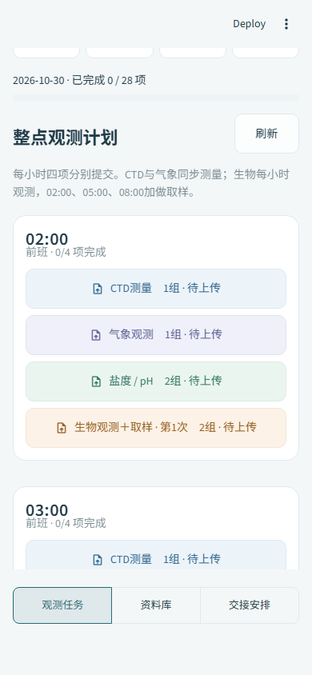

# 东方红2 · 海上观测协作站

使用 Streamlit 的海上实习资料上传网站。按照已确认的4组人员、02:00—08:00作业安排执行；没有演示数据，没有额外观测项目，也不生成Excel。


手机页面按时刻显示作业卡片，时间、项目、小组和状态直接展示在卡片里；日期与小组筛选位于主页，底部固定切换“观测任务 / 资料库 / 交接安排”。任务按钮支持换行，适配320—430像素手机宽度，无需横向拖动表格。



打开网站先完整展示D海研学队原始海报1.5秒，随后用1.5秒渐渐淡出，进入观测主页；提交材料、切换日期或筛选小组时不重复播放。主页使用提供的东方红2日落照片。两张图片都作为本地资源随源码保存，无需依赖外部图片链接。

## 作业安排

| 时刻 | CTD | 同步气象 | 海水盐度 / pH | 海洋生物观测与取样 |
| --- | --- | --- | --- | --- |
| 02:00 | 1组 | 1组 | 2组 | 2组 · 观测＋第1次取样 |
| 03:00 | 1组 | 1组 | 2组 | 2组 · 仅观测 |
| 04:00 | 1组 | 1组 | 2组 | 2组 · 仅观测 |
| 05:00 | 1组 | 1组 | 2组 | 2组 · 观测＋第2次取样 |
| 06:00 | 3组 | 3组 | 4组 | 4组 · 仅观测 |
| 07:00 | 3组 | 3组 | 4组 | 4组 · 仅观测 |
| 08:00 | 3组 | 3组 | 4组 | 4组 · 观测＋第3次取样 |

05:20—05:30仅交接：1组→3组，2组→4组。前班02:00—05:30，后班05:20—08:00。每个整点有CTD、气象、盐度/pH、生物观测4项独立提交，共28项。CTD与气象同步测量、分别上传和确认群汇报；海洋生物每小时观测并提交，02:00、05:00、08:00加做拖网取样，与对应时刻的生物观测一并提交。

## 使用流程

1. 选择实际观测日期，点击相应时刻、项目和小组的任务。
2. 选择本组提交人，填写实际完成时间，上传原始数据、记录、照片或压缩包。
3. 材料保存成功后，复制生成的群汇报文字并发到工作群。
4. 点击“我已在群里汇报，确认完成”，任务才标为已完成。

每次最多20个文件，单个100MB，合计250MB。CTD入口只提交CTD材料，气象入口只提交气象材料，二者互不等待；空文件会被拒绝。生物任务每小时都需要提交材料，无取样的时刻提交观测记录和照片即可。文件按日期、任务和提交编号分别保存，同名文件不会相互覆盖。重新提交保留历史版本，进度以最新版本为准。系统只生成汇报文字，**不会自动向微信或其他群发消息**。

资料库支持查看历史提交、下载原文件、打包单条提交和下载当天JSON清单。不同日期的任务和进度相互独立。

## 上传后直接保存到GitHub

当前默认使用GitHub作为材料存储，目标是`Pan-gao-1219/DFH2DATA`的 **observation-data** 分支。源码仍在main分支，上传数据不触发网站重新部署。

- 只有GitHub确认提交成功，网页才显示“材料已保存”。网络或权限失败会报错，保留本次文件后可以重试。
- 同一次提交的材料、记录和日期索引一次提交生效；多个小组同时上传时会重新合并最新索引，不覆盖其他小组的数据。
- 原始材料在`uploads/日期/任务/提交编号/`，逐次记录在`records/`，日期索引在`indexes/`。记录、群汇报状态和文件都从GitHub读取，网站重启后可恢复。
- 数据仓库目前是公开仓库，这是用户选择的存储范围；上传材料会公开。

### Streamlit Cloud填写Secrets

先在GitHub个人设置创建fine-grained PAT，仅选择DFH2DATA仓库，授予`Contents: Read and write`。`Metadata: Read-only`保持默认。仓库的Deploy keys是另一种SSH凭据，本网站API接入使用PAT。

打开Streamlit应用的App settings → Secrets，填写下面内容，将token值替换成你的令牌：

```toml
storage_backend = "github"

[github]
repository = "Pan-gao-1219/DFH2DATA"
branch = "observation-data"
token = "这里替换成你的GitHub个人访问令牌"
use_gh_cli = false
```

保存后重启应用。展开页面下方“材料保存位置”可查看“GitHub仓库保存”，点击“打开GitHub数据分支”即可核对原始材料。没有配置令牌时，网站允许读取公开材料，禁用上传。

模板在`.streamlit/secrets.example.toml`。实际令牌只能保存在Streamlit Secrets、环境变量`MARINE_GITHUB_TOKEN`或本机被Git忽略的`.streamlit/secrets.toml`中，不能提交到源码仓库。

本机已经登录GitHub CLI时，默认从现有登录凭据读取令牌到服务器内存，不打印、不另存文件；Cloud环境使用上面的Secrets配置。

GitHub单文件有100MB限制，大量视频或持续增长的大型原始数据不适合长期存进Git仓库。本网站仍限制每次20个文件、单文件100MB、总计250MB。海上网络中断时GitHub模式不会假装上传成功；要离线暂存，可明确切换到下文的local模式，联网后重新提交。

官方参考：[GitHub令牌设置](https://docs.github.com/en/authentication/keeping-your-account-and-data-secure/managing-your-personal-access-tokens)、[GitHub文件与API限制](https://docs.github.com/en/rest/git/blobs)。

## 本地启动

需要 Python 3.10+（建议3.12）。Windows可在本目录运行：

```powershell
powershell -ExecutionPolicy Bypass -File .\启动网站.ps1
```

跨平台：

```bash
python -m venv .venv
# Windows: .venv\Scripts\activate
# macOS / Linux: source .venv/bin/activate
python -m pip install -r requirements.txt
python -m streamlit run streamlit_app.py --server.address 0.0.0.0
```

电脑浏览器打开 http://localhost:8501 。同一局域网的同学可通过 `http://运行电脑的局域网IP:8501` 访问，需要电脑持续开机并允许该端口连接。

## 部署公网网站

GitHub用于保存源码；GitHub Pages不能直接运行这个Python程序。

### Streamlit Community Cloud

在 https://share.streamlit.io/ 登录GitHub并创建应用，选择：

- Repository：`Pan-gao-1219/DFH2DATA`
- Branch：`main`
- Main file path：`streamlit_app.py`
- Python：3.12

点击Deploy后平台会生成实际的 `.streamlit.app` 链接。提交GitHub不等于已在Streamlit Cloud完成部署。

默认的GitHub模式将材料与记录保存在GitHub数据分支，可以跨Cloud重启保留。若明确选择local模式，Community Cloud本地磁盘仍然没有持久存储保证。

### 服务器 / Docker（持久保存材料）

```bash
docker compose up -d --build
```

访问服务器8501端口；公网正式使用时在反向代理配置HTTPS和访问权限。Docker命名卷 `marine-data` 持久保存数据库和文件，不要使用 `docker compose down -v` 删除数据卷。

GitHub模式在服务器和Docker上同样需要配置`MARINE_GITHUB_TOKEN`。如果需要本地离线保存，设置`MARINE_STORAGE=local`（或Secrets根级`storage_backend="local"`）。local模式数据目录是项目下的`data/`，可通过`MARINE_DATA_DIR`设置为持久磁盘路径。备份时停止应用后完整复制数据目录，包含SQLite数据库和uploads文件夹。一个local部署实例共享同一目录，支持多浏览器并发提交；不要把多个SQLite实例分散到不同机器上。

本应用默认面向可信实习小组，未实现个人账号认证；不要把无访问限制的公网链接当作身份验证。

## 检查

```bash
python -m pip install -r requirements-dev.txt
python -m pytest -q
```

测试覆盖排班、材料保存、两类同步材料校验、重提历史、幂等提交、群汇报状态及Streamlit界面交互。
