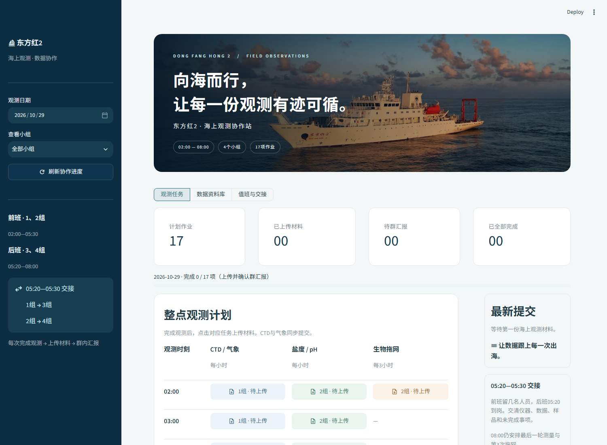

# 东方红2 · 海上观测协作站

使用 Streamlit 的海上实习资料上传网站。按照已确认的4组人员、02:00—08:00作业安排执行；没有演示数据，没有额外观测项目，也不生成Excel。



打开网站先展示D海研学队原始海报1秒，随后用0.85秒渐渐淡出，进入观测主页；提交材料、切换日期或筛选小组时不重复播放。主页使用提供的东方红2日落照片。两张图片都作为本地资源随源码保存，无需依赖外部图片链接。

## 作业安排

| 时刻 | CTD＋同步气象 | 海水盐度 / pH | 海洋生物拖网 |
| --- | --- | --- | --- |
| 02:00 | 1组 | 2组 | 2组 · 第1次 |
| 03:00 | 1组 | 2组 | — |
| 04:00 | 1组 | 2组 | — |
| 05:00 | 1组 | 2组 | 2组 · 第2次 |
| 06:00 | 3组 | 4组 | — |
| 07:00 | 3组 | 4组 | — |
| 08:00 | 3组 | 4组 | 4组 · 第3次 |

05:20—05:30仅交接：1组→3组，2组→4组。前班02:00—05:30，后班05:20—08:00。共17项提交任务；CTD和气象作为一项同步作业，分别上传两类材料。

## 使用流程

1. 选择实际观测日期，点击相应时刻、项目和小组的任务。
2. 选择本组提交人，填写实际完成时间，上传原始数据、记录、照片或压缩包。
3. 材料保存成功后，复制生成的群汇报文字并发到工作群。
4. 点击“我已在群里汇报，确认完成”，任务才标为已完成。

每次最多20个文件，单个100MB，合计250MB。CTD任务必须同时有CTD和气象材料；空文件会被拒绝。文件按日期、任务和提交编号分别保存，同名文件不会相互覆盖。重新提交保留历史版本，进度以最新版本为准。系统只生成汇报文字，**不会自动向微信或其他群发消息**。

资料库支持查看历史提交、下载原文件、打包单条提交和下载当天JSON清单。不同日期的任务和进度相互独立。

## 本地启动

需要 Python 3.10+（建议3.12）。Windows可在本目录运行：

```powershell
powershell -ExecutionPolicy Bypass -File .\启动网站.ps1
```

跨平台：

```bash
python -m venv .venv
# Windows: .venv\Scripts\activate
# macOS / Linux: source .venv/bin/activate
python -m pip install -r requirements.txt
python -m streamlit run streamlit_app.py --server.address 0.0.0.0
```

电脑浏览器打开 http://localhost:8501 。同一局域网的同学可通过 `http://运行电脑的局域网IP:8501` 访问，需要电脑持续开机并允许该端口连接。

## 部署公网网站

GitHub用于保存源码；GitHub Pages不能直接运行这个Python程序。

### Streamlit Community Cloud

在 https://share.streamlit.io/ 登录GitHub并创建应用，选择：

- Repository：`Pan-gao-1219/DFH2DATA`
- Branch：`main`
- Main file path：`streamlit_app.py`
- Python：3.12

点击Deploy后平台会生成实际的 `.streamlit.app` 链接。提交GitHub不等于已在Streamlit Cloud完成部署。

**Community Cloud本地磁盘不是持久存储保证**：休眠、重启或重新部署可能清除本地上传文件和SQLite记录。短期预览可用，正式集中收集材料应使用下面带持久卷的服务器部署；若使用Cloud，请及时下载材料备份。应用不把上传文件或同学的观测数据提交到GitHub。

### 服务器 / Docker（持久保存材料）

```bash
docker compose up -d --build
```

访问服务器8501端口；公网正式使用时在反向代理配置HTTPS和访问权限。Docker命名卷 `marine-data` 持久保存数据库和文件，不要使用 `docker compose down -v` 删除数据卷。

默认数据目录是项目下的`data/`，可通过`MARINE_DATA_DIR`设置为持久磁盘路径。备份时停止应用后完整复制数据目录，包含SQLite数据库和uploads文件夹。一个部署实例共享同一目录，支持多浏览器并发提交；不要把多个SQLite实例分散到不同机器上。

本应用默认面向可信实习小组，未实现个人账号认证；不要把无访问限制的公网链接当作身份验证。

## 检查

```bash
python -m pip install -r requirements-dev.txt
python -m pytest -q
```

测试覆盖排班、材料保存、两类同步材料校验、重提历史、幂等提交、群汇报状态及Streamlit界面交互。
